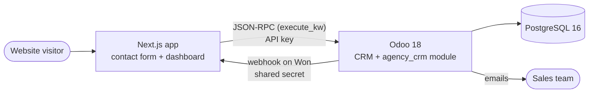

# Agency Lead Manager — Odoo CRM + Automation + Next.js

A small digital agency receives project requests from its website. Leads land
in **Odoo 18 CRM**, get qualified and assigned automatically, move through a
sales pipeline, and the team is notified at key moments. A **Next.js** site
captures leads and shows a pipeline dashboard.

Everything is configuration as code: a custom Odoo module (`agency_crm`)
defines the fields, stages, automations and demo data, so the whole setup can
be rebuilt from scratch with a couple of commands.

> 🚧 Work in progress — built phase by phase.

| Phase | Scope | Status |
| --- | --- | --- |
| 0 | Environment: Docker Compose, Odoo 18 + PostgreSQL 16, Makefile | ✅ |
| 1 | CRM configuration as code (`agency_crm` module) | ✅ |
| 2 | Automations inside Odoo (emails, assignment, scoring, reminders, quotations, webhooks, digest) | ⏳ |
| 3 | Next.js lead capture (EN/AR) over JSON-RPC | ⏳ |
| 4 | Webhook receiver + pipeline dashboard | ⏳ |
| 5 | Tests, docs and polish | ⏳ |

## Architecture



## Requirements

- Docker with Compose v2 (Docker Desktop on macOS/Windows)
- `make`

## Quick start

```bash
git clone <this repo> && cd odoo-agency-crm
make up
```

`make up` creates `.env` from `.env.example` on the first run, starts
PostgreSQL and Odoo, creates the `agency_crm` database (without Odoo's demo
data) and installs CRM, Sales, Contacts, `agency_crm` and the sample leads
from `agency_crm_sample`. The first run takes about a minute.

Open <http://localhost:8069> and log in with `admin` / `admin`
(the `ODOO_ADMIN_PASSWORD` from `.env`).

## CRM configuration (`agency_crm`)

New fields on leads/opportunities (`crm.lead`), shown on the form, the
pipeline list, the kanban cards and in the search filters:

| Field | Type | Values |
| --- | --- | --- |
| `service_type` | Selection | Website, Mobile App, ERP / CRM, Automation, Other |
| `budget` | Monetary (company currency) | Budget announced by the client |
| `lead_channel` | Selection | Website Form, Referral, LinkedIn, WhatsApp, Other |

Pipeline stages: **New → Contacted → Meeting → Proposal Sent → Won**.
Odoo's default stages are renamed through their external IDs (`crm.stage_lead1`
to `crm.stage_lead4`) and a `Meeting` stage is added.

**Lost is not a stage.** Clicking *Lost* archives the opportunity
(`active = False`, probability 0) and stores a lost reason; it keeps the stage
it was in. Lost opportunities show up with the *Lost* filter and can be
restored. The module also adds agency lost reasons (another agency, no
response, postponed).

### Sample data (`agency_crm_sample`)

Ten fictional Gulf SMEs (café, steel factory, clinic, boutique, logistics,
training center, gym, restaurant, auto parts, real estate) with one
opportunity each, spread across the stages, including one lost. They live in
their own module so they can be removed at any time by uninstalling
*Agency CRM - Sample Data* from the Apps menu.

## Configuration and passwords

All settings live in `.env` (gitignored). `.env.example` documents them.

| Variable | What it is |
| --- | --- |
| `POSTGRES_USER`, `POSTGRES_PASSWORD` | PostgreSQL account used by Odoo |
| `ODOO_DB` | Database name (`agency_crm`) |
| `ODOO_PORT` | Host port for the web UI (`8069`) |
| `ODOO_MASTER_PASSWORD` | Odoo **master password** (`admin_passwd`). Protects the database manager (`/web/database/manager`): create, back up, restore, drop databases. Not a login. |
| `ODOO_ADMIN_PASSWORD` | Login password of the `admin` **user**, applied when the database is created |

`odoo/config/odoo.conf` is a template: `odoo/scripts/entrypoint.sh` fills its
`${VAR}` placeholders from the environment when the container starts, so no
secret is committed.

## Make commands

| Command | Description |
| --- | --- |
| `make up` | Start PostgreSQL + Odoo; create the database on first run |
| `make down` | Stop containers (data is kept in Docker volumes) |
| `make logs` | Follow Odoo logs |
| `make ps` | Show container status |
| `make odoo-shell` | Python shell with `env` on the database |
| `make psql` | psql prompt on the database |
| `make init-db` | Create the database and install the base apps + our modules |
| `make install-module` | Install `MODULES` (default `agency_crm,agency_crm_sample`) |
| `make update-module` | Upgrade `MODULES` after code or data changes |
| `make test` | Run our module tests in a throwaway `test_agency_crm` database |
| `make reset-db` | Drop the database + filestore and create it again |

## Project structure

```
.
├── docker-compose.yml        # db (PostgreSQL 16) + odoo (Odoo 18)
├── Makefile                  # developer shortcuts
├── .env.example              # documented settings, copied to .env
├── odoo/
│   ├── config/odoo.conf      # Odoo config template
│   ├── scripts/              # container entrypoint, setup scripts
│   └── addons/
│       ├── agency_crm/       # fields, views, stages, (phase 2) automations, tests
│       └── agency_crm_sample/  # sample leads, uninstall to remove
└── web/                      # Next.js app (phase 3)
```

## Troubleshooting

- **Port 8069 already in use**: set another `ODOO_PORT` in `.env`.
- **Something failed**: `docker compose logs odoo --tail=200`.
- **Start over**: `make reset-db` (database only) or
  `docker compose down -v` (removes all volumes), then `make up`.

## Automations

_Coming in phase 2._

## Screenshots

_Coming soon._

## What I learned

_Written at the end of the project._
